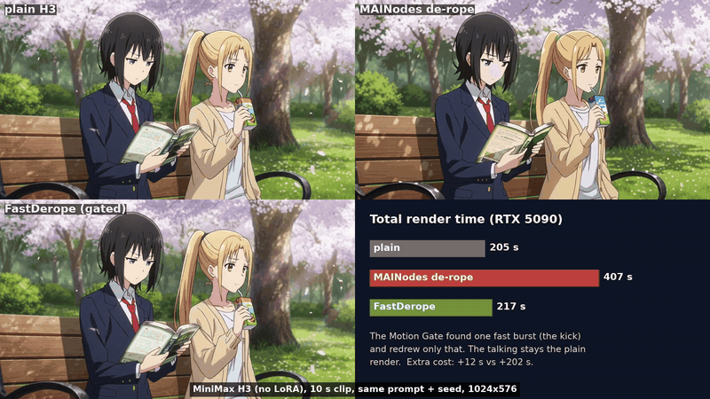
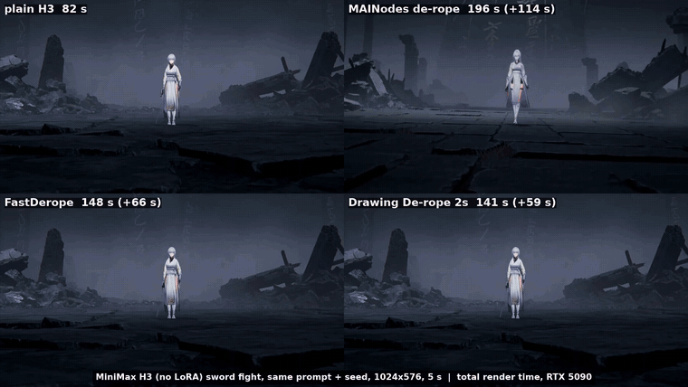

# ComfyUI-H3-FastDerope

A cheaper, smarter **de-rope** for **MiniMax H3**: the fix for fast-motion smearing and melting. It redraws only the
moments that need it, at a fraction of the usual extra cost, and splices them cleanly back into your original render.



*Plain H3 (no LoRA), 1024×576, a 10 s clip that is mostly talking with one fast kick. Top left: plain render, the girl
smears into a ghost on the kick. Top right: [MAINodes](https://github.com/matlowai/ComfyUI-MAINodes) de-rope, which
slows and redraws the fastest quarter of the whole clip. Bottom left: this pack. The Motion Gate finds the kick and
redraws only that, so the fix costs **+12 s instead of +202 s** (205 s plain, 407 s MAINodes, 217 s FastDerope; every
run from scratch on an RTX 5090).* ([mp4](assets/demo_gate_park_kick.mp4))



*The other extreme: a 5 s sword fight that is action from start to finish, so the gate can't skip anything (plain
H3, no LoRA, 1024×576). Top left: plain render, the sword hand and the warrior smear. Top right: MAINodes de-rope.
Bottom: this pack, per-frame (workflow 01) and on 2s (workflow 03). Same fix: **+66 s and +59 s instead of +114 s**
(82 s plain, 196 s MAINodes, 148 s and 141 s; RTX 5090).* ([mp4](assets/demo_sword_fight.mp4))

The de-rope itself (slow the fast spans down, redraw them, drop the extra frames) is **MAINodes' work** by
matlowai. This pack makes it cheaper, gates it and cleans up the splices; you need MAINodes installed.

---

## Which workflow?

| workflow | use it when | result in the fast bursts |
|---|---|---|
| [`01_fast_derope.json`](example_workflows/01_fast_derope.json) | the default | redrawn crisp, a new picture every frame |
| [`02_fast_derope_plus_anime_cadence.json`](example_workflows/02_fast_derope_plus_anime_cadence.json) | you want the whole clip on 2s/3s | as 01, then [Anime Cadence](https://github.com/tazmannner/ComfyUI-H3-AnimeCadence) holds everything on 2s/3s |
| [`03_drawing_derope_2s.json`](example_workflows/03_drawing_derope_2s.json) | long bursts, anime look | only every 2nd frame is redrawn; each drawing is held for 2 frames (animating on 2s) |

All three skip pass 2 entirely when nothing in the clip moves fast enough to smear. Pass 1 is always your normal
render, and its soundtrack is the final audio.

## Why H3 smears (what we measured)

- **The latent is not the bottleneck.** H3's VAE encodes and decodes clips with crisp fast poses at normal 24 fps
  almost losslessly (de-roped outputs, real fast anime). One latent token *can* hold four distinct fast poses.
- **The model paints the blur.** Re-rendering an already clean, fast clip at normal speed (from sigma 0.92, even
  from 0.79) smears it again. H3 learned, mostly from live action, that big motion *inside* a latent token goes with
  motion blur.
- That's why the de-rope works: its frame holds give every fast pose its own static token, and H3 draws static
  tokens crisply. It's also why it's expensive: the slowed clip is 2.3-3.3x longer, and full attention grows with
  the square of its length, so the redraw costs 5-8x a normal step.

## How it works

```
pass 1 (normal render + audio)
  └─ Motion Gate ── nothing extreme? ──► done: the plain render (pass 2 never runs)
       │ burst found
       ├─ H3 Time Smear (01/02)  or  Drawing Smear (03)    slow the burst down
       ├─ Freeze Mask ─► H3 V2V Init                         lock the handles and static background to pass 1
       ├─ pass 2 with H3 Window Attention (turbo LoRA)       redraw the slowed burst
       ├─ H3 Exact Recover (01/02)  or  Drawing Recover (03) back to real time
       └─ Segment Splice                                     paste the burst into pass 1, cleanly
```

### What makes it cheap

1. **Motion Gate: de-rope only extreme motion.** MAINodes' Jerk Oracle ranks motion against the clip itself, so it
   always slows the fastest ~25% of *every* clip, including talking heads and shot cuts, which also made redrawn
   mouths look off. The Motion Gate measures motion in absolute terms: optical flow on pass 1, camera pans removed,
   summed over 4-frame windows (one latent token). Only motion above 0.09 frame widths per window for at least 5
   windows counts. Isolated whole-frame changes are shot cuts (ignored); clustered ones (explosions, flashes) count
   as action. Only the burst plus 12-frame handles is redrawn. **If nothing is extreme, pass 2 never runs.**
2. **H3 Window Attention for the redraw.** Each video frame attends *exactly* to its neighbours (±4 latent frames),
   every 8th frame as an anchor, and all text, audio and first-frame rows. Attention cost becomes roughly linear in
   clip length: **pass 2 ~35-40% faster**, and fast poses came out as crisp as with full attention or crisper (a punch
   at the camera stayed sharp where full attention softened it). Unlike ComfyUI's block-sparse attention, nothing
   near the motion is dropped by guesswork. It is not a one-pass fix: on a normal render it just gives a different
   take.
3. **taeh3 for the throwaway VAE work.** Decoding pass 1 for the smear and encoding the slowed clip use the tiny
   taeh3 autoencoder (34 s → 2 s): pass 2 starts from 92% noise, so full VAE precision is wasted there. The int8 H3
   video VAE does the final decode (same picture, ~2x faster).
4. **Drawing De-rope (workflow 03).** Anime only shows a new drawing every 2 frames during action, so the in-between
   frames of a burst never need their own token. *Drawing Smear* keeps one frame per 2-frame slot and gives each
   drawing exactly one static latent token, aligned to H3's token grid. Key poses (impacts, direction reversals) get
   two tokens so pass 2 commits to them, and every shot cut starts a new drawing. *Drawing Recover* holds each
   redrawn drawing over its slot: the burst comes back crisp and already on 2s, with pass 2 8-26% cheaper than
   workflow 01 (more on long bursts).

### What makes it clean

5. **No ghosting at the splice.** Where the redrawn burst meets pass 1, a plain crossfade blends two different takes
   of the same moment into a see-through double image. *Freeze Mask* locks the outer handle frames to pass 1 inside
   pass 2 (via H3 V2V Init, `time_varying` on), so the crossfade only blends pass 1 with itself. If a shot cut falls
   inside a handle, the Motion Gate ends the redraw exactly on the cut instead (hard switch, no crossfade).
6. **Static background lock.** Regions that don't move in pass 1 are frozen in pass 2 too, and Segment Splice pastes
   pass 1's own pixels back there (`restore_static`): the background keeps its full detail and stops shimmering.
   Fine-edge detail in redrawn static-camera shots went from 87% to 94% of pass 1's; moving-camera shots are
   unaffected.

## Results (RTX 5090)

Every run computed from scratch (nothing cached), 1024×576×124 unless noted. "MAINodes" is MAINodes' fast flow
(turbo pass 2, inject 0.5) with full attention and the full VAE, no gate. "FastDerope (no gate)" redraws the same
spans as MAINodes, so it isolates the window attention + taeh3 savings:

| clip | plain | MAINodes de-rope | FastDerope (no gate) |
|---|---|---|---|
| sword fight, Edgerunners LoRA | 101 s | 231 s (2.29x) | 159 s (1.57x) |
| Re:Zero LoRA, i2v | 106 s | 239 s (2.25x) | 168 s (1.58x) |
| Edgerunners LoRA, i2v | 106 s | 208 s (1.95x) | 153 s (1.44x) |
| Teen Titans LoRA, punch | 100 s | 199 s (2.00x) | 143 s (1.44x) |
| Golden Boy LoRA, punch (768×576) | 71 s | 144 s (2.02x) | 106 s (1.49x) |
| plain H3, sword fight | 98 s | 233 s (2.39x) | 160 s (1.64x) |
| plain H3, punch | 96 s | 206 s (2.15x) | 147 s (1.53x) |
| plain H3, dance | 96 s | 198 s (2.07x) | 144 s (1.49x) |
| **all 8** | 774 s | 1659 s (2.14x) | **1178 s (1.52x)** |

With the Motion Gate (the default) the cost follows the content:

| clip | plain | MAINodes de-rope | FastDerope (gated) |
|---|---|---|---|
| 10 s park chat with one kick, plain H3 (the demo above) | 205 s | 407 s (+202 s) | **217 s (+12 s)**, only the kick redrawn |
| 5 s two-girl dialogue, Edgerunners LoRA | (not timed) | | 83 s total: nothing extreme, pass 2 skipped |
| 15 s three-shot dialogue, Edgerunners LoRA, 1344×768 | 981 s | | ~1015 s (pass 2 skipped) |
| 15 s fast-cut fight, Edgerunners LoRA, 1344×768 | 1067 s | | ~1306 s (1.22x, four bursts redrawn) |
| 5 s rocket ride, Edgerunners LoRA, 1344×768 (action all the way) | 197 s | | ~316 s (1.6x, whole clip redrawn) |

Pass-2 time only (same pass 1), per-frame vs Drawing De-rope, and v0.3's clean splices + static lock:

| clip | 01 FastDerope v0.1 | 01 v0.3 | 03 Drawing 2s v0.2 | 03 v0.3 |
|---|---|---|---|---|
| plain H3, 10 s park chat + kick | 24 s | 24 s | 22 s | 19 s |
| Teen Titans LoRA, punch | 51 s | 56 s | 47 s | 51 s |
| plain H3, sword fight | 68 s | 73 s | 59 s | 64 s |
| rocket ride, Edgerunners LoRA, 1344×768 | 141 s | | 104 s | |

On 3s the Drawing De-rope is cheaper still, but fast fists came out ghosted, so the node defaults to 2s.

Graded by eye on the fastest frames: same choreography and the same smear fixes as MAINodes' de-rope on
Edgerunners, Re:Zero, Teen Titans, Golden Boy and plain H3 clips.

## Nodes

| node | what it does |
|---|---|
| **Motion Gate (de-rope only extreme motion)** | IMAGE (pass 1, a taeh3 decode is enough) + MAINodes oracle `hold_map` → cropped burst frames, segment `hold_map`, `splice_map`, `segment_start`, report. Ends the burst on a shot cut when one falls in a handle; `freeze_frames` (8) marks the outer handle frames to lock |
| **H3 Window Attention (fast de-rope pass)** | MODEL patch for pass 2: temporal window attention (`window` latent frames each side, `anchor_stride`, `chunk`); calls under `min_frames` latent frames stay dense |
| **Freeze Mask (lock splice handles to pass 1)** | per-frame regenerate/freeze MASK for H3 V2V Init (set `time_varying` on): locks the gate's outer handle frames and, with `segment_images`, the static background (`static_threshold` 0.03) |
| **Segment Splice (skip pass 2 if calm)** | pastes the recovered burst into the full-quality pass 1; lazy input, so pass 2 only runs when the gate found something. `frozen` keeps the crossfade inside the locked frames; `restore_static` (0.03) pastes pass 1's pixels on static regions |
| **Drawing Smear (de-rope only the drawings)** | replaces H3 Time Smear in workflow 03: one token-aligned static token per 2s drawing in the burst (`every`, `key_poses`, `key_tokens`), `drawing_map` |
| **Drawing Recover (hold drawings on 2s/3s)** | replaces H3 Exact Recover in workflow 03: holds each redrawn drawing (sharpest frame of its token) over its slot |
| **Load TAE as VAE (taeh3)** | loads a video TAE from `models/vae_approx` as a normal VAE for VAEEncode / VAEDecode |
| **Color Anchor (experimental, not in the examples)** | MODEL patch for pass 2: keeps the slowed clip's coarse colours while sigma >= `sigma_low`. Cut colour drift ~20% on the sword fight, but on a huge, very fast motion (a fist filling the frame) it pulled the neighbouring pose back in as a faint see-through double |

## Example workflows

All three are wired the same way up to pass 2 (see *How it works*): pass 1 → Motion Gate → smear → Freeze Mask →
H3 V2V Init (`mask` + `time_varying` on) → pass 2 with Window Attention → recover → Segment Splice → save with pass 1's
audio. They run on plain H3; to use a **style LoRA**, add a Load LoRA right after *Load Diffusion Model* and feed its
output to **both** the pass-1 *ModelSampling (12 / 3)* and the *turbo LoRA for pass 2*, so the redrawn bursts keep
the style.

Updating from v0.1/v0.2: re-download the examples. Older copies still run, but without the Freeze Mask wires (no
ghosting fix, no static lock).

## Install

```bash
cd ComfyUI/custom_nodes
git clone https://github.com/tazmannner/ComfyUI-H3-FastDerope
```

| needs | |
|---|---|
| [matlowai/ComfyUI-MAINodes](https://github.com/matlowai/ComfyUI-MAINodes) | Jerk Oracle, Time Smear, V2V Init, Inject Schedule, Exact Recover |
| [ComfyUI-VideoHelperSuite](https://github.com/Kosinkadink/ComfyUI-VideoHelperSuite) | video save in the examples |
| `taeh3.safetensors` in `models/vae_approx` | from [madebyollin/taehv](https://github.com/madebyollin/taehv): the **encoder+decoder** version (~23 MB), not the ~10 MB preview decoder ComfyUI uses for live previews |
| an H3 turbo LoRA for pass 2 | the examples use `minimax_h3_DMAD_4step_full_lora_avg_rank_39_bf16` at 0.8 |
| OpenCV (Motion Gate) | most ComfyUI installs have it; else `pip install opencv-python-headless` |
| MiniMax H3 models | see [Comfy-Org/MiniMax-H3](https://huggingface.co/Comfy-Org/MiniMax-H3); the int8 video VAE is optional (use fp16) |

## Settings worth knowing

- **Long clips at high resolution:** 15 s at 1344×768 with slow-down 4 is ~280k tokens in pass 2 and ran out of
  memory on 32 GB with workflow 01. Set `d_max` to 3 on the Motion Gate and H3 Time Smear; it fit and still fixed
  the smear. Workflow 03 redraws far fewer frames.
- `threshold` (0.09) and `min_windows` (5) on the Motion Gate: lower them to catch brief flashes, at the cost of
  redrawing gentler motion.
- `static_threshold` / `restore_static` (0.03): how still a region must be in pass 1 to keep pass 1's pixels. Set
  both to 0 to redraw the whole frame inside a burst.
- DMAD turbo for pass 2 looked better than a 12-step base-model pass 2 (which was grainier and +60% time). DMAD
  likes `shift_audio` 2.
- **taeh3:** if the loader says the file "has no encoder", you picked the preview decoder; choose the
  encoder+decoder taeh3.
- **Faster pass 1 (optional, not in the examples):** 14 steps instead of 20 gave nearly the same take, 26% faster.
  DMAD 0.8 on pass 1 at 8 steps (simple schedule, audio shift 2) halves pass 1 but gives a different, calmer take.
  Step caching (EasyCache/LazyCache) also speeds pass 1 up but smudged the fastest frames, so it isn't recommended.

## Limitations

- The gate misses brief flash-melts that don't come with sustained motion (one Edgerunners i2v head-flash).
- Multiple bursts far apart are redrawn as one window from the first to the last burst.
- Fast-moving characters in a redrawn burst lose some fine detail compared to the plain render (pass 2 redraws them
  from 92% noise with a turbo LoRA); they are crisp, not blurred or melted. Static backgrounds keep pass 1's detail
  (v0.3), moving-camera shots don't benefit from that. Thin repeated patterns (chain-link fences) can pick up
  artifacts in pass 2.
- The v0.3 locks add ~4-5 s to pass 2 on clips that are action all the way through.
- On a very short burst the Drawing De-rope saves almost nothing over workflow 01.
- Tested on MiniMax H3 at 768×576 to 1344×768, 5–15 s, graded by eye on the fastest frames. Not a benchmark.

## Changelog

- **v0.3.0**: no more ghosting at splice edges (Freeze Mask + cut-aware Motion Gate); static background lock with
  pass-1 pixel restore; Color Anchor (experimental); clearer taeh3 error; new header demo.
- **v0.2.0**: Drawing De-rope (Drawing Smear / Recover, workflow 03).
- **v0.1.0**: Window Attention, Motion Gate + Segment Splice, taeh3 loader.

## Thank you

- **matlowai** for [ComfyUI-MAINodes](https://github.com/matlowai/ComfyUI-MAINodes): the de-rope pipeline this pack
  builds on, and the idea that fast motion needs more latent tokens.
- **madebyollin** for [taehv / taeh3](https://github.com/madebyollin/taehv).
- **MiniMax** for [MiniMax H3](https://huggingface.co/MiniMaxAI/MiniMax-H3), the
  [ComfyUI](https://github.com/comfyanonymous/ComfyUI) team, and **Kosinkadink** for VideoHelperSuite.
- **[Claude](https://www.anthropic.com/claude) (Anthropic)**, via Claude Code, which designed and wrote the nodes,
  ran the experiments and measurements behind the findings above, and put together this repo, working from
  tazmannner's direction, testing and review.

## License

[MIT](LICENSE). All code here was written for this project. The example workflows use nodes from
ComfyUI-MAINodes (GPL-3.0), which you install separately; no MAINodes code is included.
