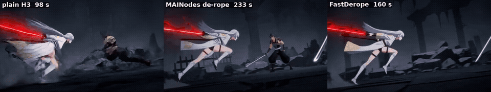

# ComfyUI-H3-FastDerope

A cheaper, smarter **de-rope** for **MiniMax H3**: the fix for fast-motion smearing and melting, at roughly half
the extra cost, and only where a shot actually needs it.



*Plain H3 (no LoRA), 1024×576, 5 s sword fight, half speed. Left: plain render, the warrior smears into the slash.
Middle: [MAINodes](https://github.com/matlowai/ComfyUI-MAINodes) de-rope. Right: this pack. Same fix, 160 s instead
of 233 s (a plain render is 98 s).* ([mp4](assets/demo_plainH3_sword_fight.mp4))

The de-rope itself (slow the fast spans down, redraw them, drop the extra frames) is **MAINodes' work** by
matlowai. This pack makes it cheaper and gates it; you need MAINodes installed.

---

## Why H3 smears (what we measured)

- **The latent is not the bottleneck.** H3's VAE encodes and decodes clips with crisp fast poses at normal 24 fps
  almost losslessly (de-roped outputs, real fast anime). One latent token *can* hold four distinct fast poses.
- **The model paints the blur.** Re-rendering an already clean, fast clip at normal speed (from sigma 0.92, even
  from 0.79) smears it again. H3 learned, mostly from live action, that big motion *inside* a latent token goes with
  motion blur.
- That's why the de-rope works: its frame holds give every fast pose its own static token, and H3 draws static
  tokens crisply. It's also why it's expensive: the slowed clip is 2.3-3.3x longer, and full attention grows with
  the square of its length, so the redraw costs 5-8x a normal step.

## What this pack changes

1. **H3 Window Attention** for the redraw (pass 2). Each video frame attends *exactly* to its neighbours (±4 latent
   frames), every 8th frame as an anchor, and all text, audio and first-frame rows; text and audio still see
   everything. Attention cost becomes roughly linear in clip length: **pass 2 ~35-40% faster**, and fast poses came
   out as crisp as with full attention or crisper (a punch at the camera stayed sharp where full attention softened
   it). Unlike ComfyUI's block-sparse attention, nothing near the motion is dropped by guesswork. It is not a
   one-pass fix: on a normal render from step 0 it just gives a different take.
2. **Motion Gate + Segment Splice: de-rope only extreme motion.** MAINodes' Jerk Oracle ranks motion against the
   clip itself, so it always slows the fastest ~25% of *every* clip, including talking heads and shot cuts, which
   made redrawn mouths look off. The Motion Gate measures motion in absolute terms: optical flow on pass 1, camera
   pans removed, summed over 4-frame windows (one latent token). Only motion above 0.09 frame widths per window for
   at least 5 windows counts. Isolated whole-frame changes are shot cuts (ignored); clustered ones (explosions,
   flashes) count as action. The burst plus 12-frame handles is redrawn and spliced back into the full-quality pass 1
   with a crossfade. **If nothing is extreme, pass 2 never runs** and you get the plain render, lip sync untouched.
3. **taeh3 for the throwaway VAE work.** Decoding pass 1 for the time smear and encoding the slowed clip use the tiny
   taeh3 autoencoder (34 s → 2 s): pass 2 starts from 92% noise, so full VAE precision is wasted there. Use the int8
   H3 video VAE for the final decode (same picture, ~2x faster).

4. **Drawing De-rope (on 2s, optional).** Anime only shows a new drawing every 2 frames during action, so the
   in-between frames of a burst never need their own token. *Drawing Smear* keeps one frame per 2-frame slot inside
   the hot span and gives each drawing exactly one static latent token, aligned to H3's token grid. Key poses
   (impacts, direction reversals) get two tokens, so pass 2 commits to them, and every shot cut starts a new drawing.
   *Drawing Recover* holds each redrawn drawing over its slot, so the burst comes back crisp and already on 2s. Pass 2
   was 8-26% cheaper than the per-frame version above, with the same crispness and the impacts on the same frames.

5. **Clean splices (no ghosting).** Where the redrawn burst meets pass 1, a crossfade used to blend two different
   takes of the same moment into a see-through double image. Now *Freeze Mask* locks the outer handle frames to pass 1
   inside pass 2 (H3 V2V Init, `time_varying` on), so the crossfade only blends pass 1 with itself; a handle that
   contains a shot cut is switched exactly on the cut instead.
6. **Static background lock.** Regions that don't move in pass 1 are frozen in pass 2 as well, and Segment Splice
   pastes pass 1's own pixels back there (`restore_static`): the background keeps its full detail and stops
   shimmering. Fine-edge detail in redrawn static-camera shots went from 87% to 94% of pass 1's; moving-camera shots
   are unaffected.
7. **Color Anchor.** During pass 2's high-noise steps the coarse colour layout of pass 1 is kept and only finer
   detail is redrawn, so costume colours can't drift (it cut colour drift ~20% on the sword fight, no time cost).

Pass 1 is your normal render and its soundtrack is the final audio.

## Results (RTX 5090)

Every run computed from scratch (nothing cached), 1024×576×124 unless noted. "MAINodes" is MAINodes' fast flow
(turbo pass 2, inject 0.5) with full attention and the full VAE, no gate:

| clip | plain | MAINodes de-rope | FastDerope (no gate) |
|---|---|---|---|
| sword fight, Edgerunners LoRA | 101 s | 231 s (2.29x) | 159 s (1.57x) |
| Re:Zero LoRA, i2v | 106 s | 239 s (2.25x) | 168 s (1.58x) |
| Edgerunners LoRA, i2v | 106 s | 208 s (1.95x) | 153 s (1.44x) |
| Teen Titans LoRA, punch | 100 s | 199 s (2.00x) | 143 s (1.44x) |
| Golden Boy LoRA, punch (768×576) | 71 s | 144 s (2.02x) | 106 s (1.49x) |
| plain H3, sword fight | 98 s | 233 s (2.39x) | 160 s (1.64x) |
| plain H3, punch | 96 s | 206 s (2.15x) | 147 s (1.53x) |
| plain H3, dance | 96 s | 198 s (2.07x) | 144 s (1.49x) |
| **all 8** | 774 s | 1659 s (2.14x) | **1178 s (1.52x)** |

With the Motion Gate (default) the cost follows the content:

| clip | plain | FastDerope (gated) |
|---|---|---|
| 5 s two-girl dialogue, Edgerunners LoRA | (not timed) | 83 s total: nothing extreme, pass 2 skipped |
| 15 s three-shot dialogue, Edgerunners LoRA, 1344×768 | 981 s | ~1015 s (pass 2 skipped) |
| 15 s fast-cut fight, Edgerunners LoRA, 1344×768 | 1067 s | ~1306 s (1.22x, four bursts redrawn) |
| 5 s rocket ride, Edgerunners LoRA, 1344×768 (action all the way) | 197 s | ~316 s (1.6x, whole clip redrawn) |

Drawing De-rope on 2s vs the per-frame FastDerope, pass-2 seconds only (same pass 1):

| clip | FastDerope pass 2 | Drawing De-rope 2s pass 2 |
|---|---|---|
| Teen Titans LoRA, punch, 1024×576 | 51 s | 47 s |
| plain H3, sword fight, 1024×576 | 68 s | 59 s |
| rocket ride, Edgerunners LoRA, 1344×768 | 141 s | 104 s |

On 3s it is cheaper still, but fast fists came out ghosted; fixed-phase 2s (no key poses) is 22-40% cheaper but can
land an impact a frame or two late.

Graded by eye on the fastest frames: same choreography and the same smear fixes as MAINodes' de-rope on
Edgerunners, Re:Zero, Teen Titans, Golden Boy and plain H3 clips.

## Nodes

| node | what it does |
|---|---|
| **H3 Window Attention (fast de-rope pass)** | MODEL patch for pass 2: temporal window attention (`window` latent frames each side, `anchor_stride`, `chunk`); calls under `min_frames` latent frames stay dense |
| **Motion Gate (de-rope only extreme motion)** | IMAGE (pass 1, a taeh3 decode is enough) + MAINodes oracle `hold_map` → cropped burst frames, segment `hold_map` for H3 Time Smear, `splice_map`, `segment_start`, report |
| **Segment Splice (skip pass 2 if calm)** | pastes the recovered burst into the full-quality pass 1; lazy input, so pass 2 only runs when the gate found something |
| **Drawing Smear (de-rope only the drawings)** | replaces H3 Time Smear: Motion Gate segment + hold_map → one token-aligned static token per 2s drawing in the hot span (`every`, `key_poses`, `key_tokens`), `drawing_map` |
| **Drawing Recover (hold drawings on 2s/3s)** | replaces H3 Exact Recover: holds each redrawn drawing (sharpest frame of its token) over its slot |
| **Freeze Mask (lock splice handles to pass 1)** | per-frame regenerate/freeze MASK for H3 V2V Init (`time_varying` on): locks the gate's outer handle frames and, with `segment_images`, the static background |
| **Color Anchor (keep pass-1 colours in pass 2)** | MODEL patch for pass 2: keeps the init latent's coarse colours while sigma >= `sigma_low` (`strength` 0.7, `cell` 4) |
| **Load TAE as VAE (taeh3)** | loads a video TAE from `models/vae_approx` as a normal VAE for VAEEncode / VAEDecode |

## Example workflows

- [`01_fast_derope.json`](example_workflows/01_fast_derope.json): plain H3 → gated, window-attention de-rope → save.
- [`02_fast_derope_plus_anime_cadence.json`](example_workflows/02_fast_derope_plus_anime_cadence.json): the same,
  finished with *Anime Cadence* from [ComfyUI-H3-AnimeCadence](https://github.com/tazmannner/ComfyUI-H3-AnimeCadence)
  (hold on 2s/3s). Delete that node if you don't use the pack.
- [`03_drawing_derope_2s.json`](example_workflows/03_drawing_derope_2s.json): the Drawing De-rope: only the 2s drawings
  of the burst are redrawn; the burst comes back on 2s.

## Install

```bash
cd ComfyUI/custom_nodes
git clone https://github.com/tazmannner/ComfyUI-H3-FastDerope
```

| needs | |
|---|---|
| [matlowai/ComfyUI-MAINodes](https://github.com/matlowai/ComfyUI-MAINodes) | Jerk Oracle, Time Smear, V2V Init, Inject Schedule, Exact Recover |
| [ComfyUI-VideoHelperSuite](https://github.com/Kosinkadink/ComfyUI-VideoHelperSuite) | video save in the examples |
| `taeh3.safetensors` in `models/vae_approx` | from [madebyollin/taehv](https://github.com/madebyollin/taehv) (the version with an encoder) |
| an H3 turbo LoRA for pass 2 | the examples use `minimax_h3_DMAD_4step_full_lora_avg_rank_39_bf16` at 0.8 |
| OpenCV (Motion Gate) | most ComfyUI installs have it; else `pip install opencv-python-headless` |
| MiniMax H3 models | see [Comfy-Org/MiniMax-H3](https://huggingface.co/Comfy-Org/MiniMax-H3); the int8 video VAE is optional (use fp16) |

## Settings worth knowing

- **Long clips at high resolution:** 15 s at 1344×768 with slow-down 4 is ~280k tokens in pass 2 and ran out of
  memory on 32 GB. Set `d_max` to 3 on the Motion Gate and H3 Time Smear; it fit and still fixed the smear.
- `threshold` (0.09) and `min_windows` (5): lower them to catch brief flashes, at the cost of redrawing gentler motion.
- DMAD turbo for pass 2 looked better than a 12-step base-model pass 2 (which was grainier and +60% time). DMAD
  likes `shift_audio` 2.
- Shots with no fast action (dialogue, slow camera moves) gain nothing from a de-rope; the gate skips them for you.
- **taeh3:** use the encoder+decoder file (~23 MB). The ~10 MB `taeh3.safetensors` that ComfyUI uses for live previews
  has no encoder; the loader now says so instead of failing with "VAE is invalid".
- **Faster pass 1 (optional, not in the examples):** 14 steps instead of 20 gave nearly the same take, 26% faster.
  DMAD 0.8 on pass 1 at 8 steps (simple schedule, audio shift 2) halves pass 1 but gives a different, calmer take.

## Limitations

- The gate misses brief flash-melts that don't come with sustained motion (one Edgerunners i2v head-flash).
- Multiple bursts far apart are redrawn as one window from the first to the last burst.
- Redrawn bursts lose some fine detail compared to the plain render (pass 2 redraws from 92% noise with a turbo
  LoRA); they are crisp, not blurred or melted. Fine details (a small emblem) can come back a little softer; thin repeated patterns (chain-link
  fences) can pick up artifacts in pass 2.
- Tested on MiniMax H3 at 768×576 to 1344×768, 5–15 s, graded by eye on the fastest frames. Not a benchmark.

## Thank you

- **matlowai** for [ComfyUI-MAINodes](https://github.com/matlowai/ComfyUI-MAINodes): the de-rope pipeline this pack
  builds on, and the idea that fast motion needs more latent tokens.
- **madebyollin** for [taehv / taeh3](https://github.com/madebyollin/taehv).
- **MiniMax** for [MiniMax H3](https://huggingface.co/MiniMaxAI/MiniMax-H3), the
  [ComfyUI](https://github.com/comfyanonymous/ComfyUI) team, and **Kosinkadink** for VideoHelperSuite.
- **[Claude](https://www.anthropic.com/claude) (Anthropic)**, via Claude Code, which designed and wrote the nodes,
  ran the experiments and measurements behind the findings above, and put together this repo, working from
  tazmannner's direction, testing and review.

## License

[MIT](LICENSE). All code here was written for this project. The example workflows use nodes from
ComfyUI-MAINodes (GPL-3.0), which you install separately; no MAINodes code is included.
